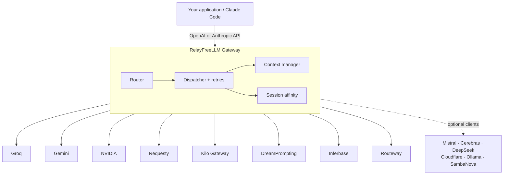

# RelayFreeLLM

> One endpoint. More free inference, fewer rate-limit surprises.

Don't want to pay for AI APIs? RelayFreeLLM is an open-source gateway that combines free-tier providers behind a single OpenAI-compatible API, with automatic failover when a model or provider runs out of quota.

```python
# Your existing code works. Just change the URL.
client = OpenAI(base_url="http://localhost:8000/v1", api_key="fake")
```

**Enabled by default:** Groq · Gemini · NVIDIA · [Requesty](https://requesty.ai/) · [Kilo Gateway](https://kilo.ai/docs/gateway) · [DreamPrompting](https://dreamprompting.com/api-docs) · [Inferbase](https://inferbase.ai/docs/api) · [Routeway](https://docs.routeway.ai) — their free tiers require no credit card.<br>
**Optional hosted clients:** Mistral · Cerebras · DeepSeek · Cloudflare · SambaNova — signup may require a credit card or payment setup.

Rather than cataloguing hundreds of free providers available on the web, RelayFreeLLM ships a curated set chosen for relatively generous free-tier quotas and reputable models.

The gateway also speaks the **Anthropic Messages API**, so coding agents like **Claude Code** can use the same local endpoint with tool calling, streaming, and Claude-style model aliases — no Anthropic account required. See [Using Claude Code](#using-claude-code).

---

## Quick Start

### 1. Install

```bash
git clone https://github.com/msmarkgu/RelayFreeLLM.git && cd RelayFreeLLM
pip install -r requirements.txt
```

Already installed? Pull the latest code and refresh dependencies with `git pull && pip install -r requirements.txt`.

### 2. Add API keys

Create a `.env` file in the project root with the keys for the providers enabled by default:

```bash
GEMINI_APIKEY=      # ai.google.dev
GROQ_APIKEY=        # console.groq.com
NVIDIA_APIKEY=      # build.nvidia.com
REQUESTY_APIKEY=    # requesty.ai
DREAMPROMPTING_APIKEY= # dreamprompting.com (free signup)
INFERBASE_APIKEY=   # inferbase.ai (free signup)
ROUTEWAY_APIKEY=    # routeway.ai (free signup)
```

The other provider clients ship in `src/api_clients/` but have no models enabled by default. To use one, add its credentials (see [`.env.example`](.env.example)) and enable its models under that provider in [`provider_model_limits.json`](src/provider_model_limits.json) or through the Admin Dashboard. Ollama needs no key — just a running local server (`OLLAMA_BASE_URL`).

**Requesty example:** Requesty is enabled by default and needs only `REQUESTY_APIKEY=<your key>` in `.env`; no credit card is required. Its free models have a daily request allowance. Requesty model ids can contain a `/` (e.g. `nvidia/nemotron-3-ultra-550b-a55b`); in specific-routing requests prefix the provider once: `requesty/nvidia/nemotron-3-ultra-550b-a55b`. Requesty routes bare model names across its own providers, so its free-tier limits are per organization, not per upstream provider.

**Kilo Gateway example:** Kilo Gateway needs no API key and no credit card. Anonymous access is limited to 200 requests/hour/IP and only to free models. In specific-routing requests prefix the provider once: `kilogateway/nvidia/nemotron-3.5-lightning:free`. Paid Kilo models are not exposed by this client.

The curated Kilo free set is chosen for coding-agent use: `kilo-auto/free` (Kilo's curated free router), `nvidia/nemotron-3-ultra-550b-a55b:free`, `nvidia/nemotron-3.5-super-vl:free`, `baidu/ernie-5.5-flash-preview:free`, and `nvidia/nemotron-3.5-lightning:free`. All five support tool calling and streaming. `kilo-auto/free` rotates underlying models, which may log prompts and outputs — avoid sending confidential code with it.

**DreamPrompting example:** DreamPrompting is enabled by default and needs a free `DREAMPROMPTING_APIKEY` from dreamprompting.com; no credit card is required. It is OpenAI-compatible, supports tool calling and streaming, and gives each account 500,000 tokens and 5,000 requests per rolling 24 hours (100 requests/minute per IP, 32,000 input tokens/request). Use `dreamprompting/auto` for gateway-managed failover, or pin a listed model such as `dreamprompting/groq/openai/gpt-oss-120b`.

**Inferbase example:** Inferbase is enabled by default and needs a free `INFERBASE_APIKEY` starting with `inf_`; no credit card is required. It is OpenAI-compatible with native tool calling and streaming. The Free plan allows 5,000 requests/month, 100 managed requests and $0.50 of managed usage/day (10 requests/minute), and caps each request at 8,192 input and 1,024 output tokens. Use `inferbase/auto` to route within the free price band; pinned models above that band are refused by Inferbase with a 402. Curated tool-capable coding models include `deepseek-v4-flash`, `openai-gpt-oss-120b`, `qwen3-coder-480b-a35b-instruct`, and `zai-glm-4-7`.

**Routeway example:** Routeway is enabled by default and needs a free `ROUTEWAY_APIKEY` from routeway.ai; no credit card is required. Its Starter plan allows 200 requests/day on free models with a shared low-priority queue and one concurrent request. Routeway is OpenAI-compatible with native tool calling and SSE streaming. Only five curated Gemma 4 26B free finetunes are exposed, such as `routeway/gemma-4-26b-a4b-it-chimerax:free`; pay-as-you-go models, Routeway's MiniMax free model (unreliable), and the uncurated Darksoul finetune are filtered out. Free-model limits are 5 requests/minute and 200/day (429 on excess).

### 3. Start the server

```bash
python -m src.server
```

### 4. Make a request

```python
from openai import OpenAI

client = OpenAI(base_url="http://localhost:8000/v1", api_key="relay-free")
response = client.chat.completions.create(
    model="meta-model",  # routes to any available model
    messages=[{"role": "user", "content": "Hello!"}],
)
print(response.choices[0].message.content)
```

To route to a specific model, pass `provider/model`:

```python
response = client.chat.completions.create(
    model="groq/qwen/qwen3.8-27b",
    messages=[{"role": "user", "content": "Hello!"}],
)
```

### 5. Use it with Claude Code

Set the token once in `.env` (see Optional setup below):

```bash
RELAY_AUTH_TOKEN=my-relay-secret-12345
```

Then run:

```bash
./scripts/relay-claude          # extra args are passed to `claude`, e.g. --resume
```

The launcher reads `.env`, starts the gateway if needed (so step 3 is optional), sets the `ANTHROPIC_*` variables, and runs Claude Code. If the gateway is already running with a token from elsewhere, put that same value in `.env` or export it in the shell. For the VS Code extension or manual setup, see [Using Claude Code](#using-claude-code).

### Optional setup

<details>
<summary><strong>Bearer token auth</strong> (recommended for agent use)</summary>

Add `RELAY_AUTH_TOKEN=your-random-secret` to `.env` to require `Authorization: Bearer <token>` on all API/admin routes. `/` and `/health` stay public. The server binds to `127.0.0.1` and allows only localhost CORS origins. Leave the value empty to disable the gate for local chat/admin use; `scripts/relay-claude` then sends a harmless placeholder credential to Claude Code.

</details>

<details>
<summary><strong>Docker</strong></summary>

```bash
docker build -t relayfreellm .
docker run --rm --env-file .env -p 127.0.0.1:8000:8000 relayfreellm
```

The image sets `HOST=0.0.0.0`; publish to loopback as shown.

</details>

<details>
<summary><strong>Verify model availability</strong></summary>

`python -m tests.test_models_availability` checks every registry model and prints a total (e.g. `TOTAL: 10/10 models available.`). Pass a provider name to filter, e.g. `python -m tests.test_models_availability Groq`.

</details>

<details>
<summary><strong>Web UIs</strong></summary>

[`/admin`](http://localhost:8000/admin) — limits and usage · [`/chat`](http://localhost:8000/chat) — streaming chat. See [Web UIs](#web-uis).

</details>

---

## Using Claude Code

RelayFreeLLM can act as a local Anthropic backend for Claude Code, in both the terminal and the VS Code extension. It exposes `/v1/messages`, `/v1/messages/count_tokens`, and a Claude-projected `/v1/models`, so no external Anthropic account is needed.

### One-command launcher

```bash
./scripts/relay-claude [extra claude args...]
```

The launcher:

- starts the gateway on `127.0.0.1:8000` if `/health` is not reachable (logs go to `relay-server.log`, override with `RELAY_LOG_FILE`);
- reads the bearer token from `RELAY_AUTH_TOKEN` in the shell or `.env`, generating a random session token if neither is set;
- scrubs inherited `ANTHROPIC_*` variables, then sets `ANTHROPIC_BASE_URL`, `ANTHROPIC_AUTH_TOKEN`, and `ANTHROPIC_MODEL` (default `claude-sonnet-5-5`);
- sets Claude Code flags for managed-provider mode, gateway model discovery, a 200k auto-compact window, and disables client watchdogs/timeouts so the gateway owns retries;
- runs `claude` with any extra arguments you pass.

If the gateway is **already running**, put the token that server was started with in `.env` (or export it in the shell); otherwise the launcher's generated token will not be accepted.

Windows: put `RELAY_AUTH_TOKEN` in `.env`, start the server separately (`python -m src.server`), then run `scripts\relay-claude.cmd`.

### Manual configuration

If you set the environment yourself:

```bash
export ANTHROPIC_BASE_URL=http://127.0.0.1:8000
export ANTHROPIC_AUTH_TOKEN="$RELAY_AUTH_TOKEN"
export ANTHROPIC_MODEL=claude-sonnet-5-5
claude
```

### VS Code extension

Install the official **Claude Code** extension from the VS Code Marketplace, start the gateway with `RELAY_AUTH_TOKEN` set, then open **Preferences: Open User Settings (JSON)** and add:

```json
{
  "claudeCode.disableLoginPrompt": true,
  "claudeCode.environmentVariables": [
    { "name": "ANTHROPIC_BASE_URL", "value": "http://127.0.0.1:8000" },
    { "name": "ANTHROPIC_AUTH_TOKEN", "value": "<RELAY_AUTH_TOKEN>" },
    { "name": "ANTHROPIC_MODEL", "value": "claude-sonnet-5-5" },
    { "name": "CLAUDE_CODE_ENABLE_GATEWAY_MODEL_DISCOVERY", "value": "1" },
    { "name": "CLAUDE_CODE_DISABLE_ADVISOR_TOOL", "value": "1" },
    { "name": "CLAUDE_ENABLE_STREAM_WATCHDOG", "value": "0" },
    { "name": "CLAUDE_ENABLE_BYTE_WATCHDOG", "value": "0" }
  ]
}
```

Reload the window, open the Claude Code panel, and run `/status`: `Anthropic base URL` should show `http://127.0.0.1:8000` and the credential should be `ANTHROPIC_AUTH_TOKEN`. With discovery enabled, switch aliases from `/model`.

- Put these in **user settings**, not a committed workspace settings file. The extension checks credentials from `claudeCode.environmentVariables` before launching; `~/.claude/settings.json` reaches the spawned process but not that login check.
- Use the same token the gateway was started with. If `scripts/relay-claude` generated a random session token because none was configured, that token is not valid for a gateway started separately.
- Third-party-provider mode has no plan usage bars, voice dictation, or cloud sessions/Remote Control.
- If you prefer the CLI inside VS Code's integrated terminal, use `scripts/relay-claude` instead; it sets the same variables for that shell.

### Model aliases

| Alias | Default backend |
|-------|-----------------|
| `claude-fable-5-2` | `kilogateway/baidu/ernie-5.5-flash-preview:free` |
| `claude-opus-5-5` | `kilogateway/nvidia/nemotron-3-ultra-550b-a55b:free` |
| `claude-sonnet-5-5` | `kilogateway/nvidia/nemotron-3.5-super-vl:free` |
| `claude-haiku-5-5` | `kilogateway/nvidia/nemotron-3.5-lightning:free` |

Override the mapping in `settings.json` under `claude.model_map`. Values are `provider/model` pairs; only tool-capable providers are considered when the request includes tools. These defaults use Kilo Gateway's keyless free endpoints because its NVIDIA-hosted models are typically faster than the direct NVIDIA equivalents. Claude Code sends large system prompts and tool schemas, so prefer backends without a tight per-minute input-token cap.

### Behaviour & limitations

- The adapter forces `X-Use-ServerSide-System-Prompt: false` internally, so Claude's own system prompt and tool-result history are forwarded verbatim. The separate [`/v1/agents/run`](#post-v1agentsrun) Map–Reduce API is unaffected.
- Streaming produces standard Anthropic SSE events; streamed tool arguments are buffered per `tool_use` block before emission.
- Thinking/reasoning from backend models is emitted as plain text, not signed Anthropic `thinking` blocks.
- Tool loops work only with providers that have native tool passthrough: **Groq, NVIDIA, Requesty, Kilo Gateway, DreamPrompting, Inferbase, and Routeway** are enabled by default; Cerebras, DeepSeek, Cloudflare, Ollama, and SambaNova can be enabled as additional providers. Free-tier tool-calling reliability varies by model — test a chosen alias before long agent runs.
- Token counts are estimates, not provider-reported usage.

---

## What You Get

| Feature | Why It Matters |
|---------|----------------|
| **OpenAI-compatible** | Drop-in for existing code: LangChain, LlamaIndex, any SDK. |
| **Anthropic-compatible** | `POST /v1/messages` and `POST /v1/messages/count_tokens` for Claude Code and other Anthropic clients. |
| **Agent tool calling** | OpenAI-style `tools`/`tool_choice` and Anthropic `tool_use`/`tool_result` blocks, with native passthrough on supported providers. |
| **Automatic failover** | Provider down or a model rate-limited? The next available model is tried automatically. |
| **Session affinity** | Pin conversations to a provider via `X-Session-ID` for context-caching benefits; sessions migrate if that provider fails. |
| **Context management** | Static, Dynamic, Reservoir, and Adaptive modes, with extractive summarization for long conversations. |
| **Consistent output style** | Universal style guidance plus response normalizers; opt out per request for agent frameworks. |
| **Intent-based routing** | `model_type=coding`, `model_scale=large`, `model_name=nvidia` — say what you need, not which API to call. |
| **Image-aware routing** | Messages with image content are routed only to vision-capable models. |
| **Real-time streaming** | Full SSE streaming from every backend provider. |
| **Local + cloud** | Mix a local Ollama instance with cloud free tiers. |
| **Web UIs** | Chat interface at [`/chat`](http://localhost:8000/chat) and admin dashboard at [`/admin`](http://localhost:8000/admin). |
| **Local-first security** | Binds to `127.0.0.1`, restricts CORS to localhost origins, and supports an optional bearer token. |
| **Honest errors & usage** | Real HTTP statuses, structured error envelopes, and token estimates on responses and the final SSE chunk. |

Useful for independent developers and students avoiding API bills, self-hosters combining Ollama privacy with cloud capacity, researchers batching queries across providers, and coding-agent users running Claude Code on free tiers.

---

## How Routing Works

### Intent-based selection

```text
{"model": "meta-model"}                         // Any provider, picks the next available
{"model": "meta-model", "model_type": "coding"} // Any coding model
{"model": "meta-model", "model_scale": "large"} // Only large models
{"model": "meta-model", "model_name": "nvidia"} // Prefer NVIDIA models
{"model": "Gemini/gemini-2.5-flash"}            // Specific provider/model
```

### Automatic failover

```
Request → Groq (rate limited)
        → Circuit breaker activates (60s cooldown)
        → Retry → Gemini
        → Retry → NVIDIA
        → Success ✓
```

### Image-aware routing

When a message contains `image_url` content parts (OpenAI Chat Completions format), the dispatcher restricts model selection to vision-capable models:

- **Meta-model routing** — only models with `modality: "vision"` in the registry are considered.
- **Specific routing** — if a text-only model is requested, the dispatcher first looks for a vision model in the same provider, then falls back to any provider's vision model. If none are available, a clear error is returned.

This is driven by the per-model `modality` field in `provider_model_limits.json`. Models without image support remain available for text-only requests.

### Tool calling

Send OpenAI-style tool definitions; tool requests are routed only to clients with native tool passthrough, and `tool_use`/`tool_result` pairs are kept intact instead of being summarised by the context manager.

```python
tools = [{
    "type": "function",
    "function": {
        "name": "get_weather",
        "parameters": {"type": "object", "properties": {"city": {"type": "string"}}},
    },
}]
response = client.chat.completions.create(model="meta-model", messages=[...], tools=tools)
call = response.choices[0].message.tool_calls[0]  # run it, append a role="tool" result, call again
```

Streaming tool calls emit `delta.tool_calls` fragments plus a final chunk with `finish_reason: "tool_calls"`. Native tool passthrough is available on **Groq, NVIDIA, Requesty, Kilo Gateway, DreamPrompting, Inferbase, and Routeway** out of the box; the Cerebras, DeepSeek, Cloudflare, Ollama, and SambaNova clients can be enabled as additional providers. Gemini and Mistral are used for text only.

### Consistent output style & agent frameworks

By default the gateway injects a universal style directive into the system prompt and normalizes responses (strips "As an AI...", fixes JSON, standardizes markdown). Agent frameworks such as LangChain, AutoGen, and CrewAI manage their own prompts and message order; disable injection with:

```
X-Use-ServerSide-System-Prompt: false
```

When disabled (per request, or server-wide via `settings.json`):

- `messages` is forwarded verbatim, preserving order and roles (including `assistant` tool calls and `tool` results).
- No server-side system prompt or style directive is added; the client's own system message is used as-is.
- If the client sent no system message, none is sent upstream.

```json
{
  "routing": { "use_server_side_system_prompt": false },
  "context": { "management_mode": "static" }
}
```

For full client-order fidelity, use `static` context management; `reservoir` and `adaptive` may still reorder or summarise long conversations. The same setting can be supplied as `CONTEXT_MANAGEMENT_MODE=static` in the environment.

### Multi-turn context management

| Mode | Behavior |
|------|----------|
| **Static** | Keeps the last N messages verbatim. |
| **Dynamic** | Adjusts the context window based on real-time token usage. |
| **Reservoir** | Recent messages verbatim + extractive summary of older history. |
| **Adaptive** | Detects coding vs chat conversations and switches strategy. |

Reservoir mode uses a TF-scoring algorithm to pick the most informative sentences, applies position bias for topicality, and greedily fits segments into the token budget — no extra LLM calls.

### Errors & usage

Failures return meaningful HTTP statuses (400/401/429/500/502) with an OpenAI-style envelope:

```json
{"error": {"message": "All retries failed...", "type": "upstream_error"}}
```

Streaming failures emit a final `data: {"error": {...}}` event instead of a fake `finish_reason: "error"`. Successful streams end with a usage chunk:

```json
{"usage": {"prompt_tokens": 12, "completion_tokens": 34, "total_tokens": 46}}
```

Token counts are estimated locally (not provider-reported), but are always non-zero so harness context budgeting works.

---

## Web UIs

### Admin Dashboard

At [`/admin`](http://localhost:8000/admin): visually edit provider limits and monitor usage — no JSON editing or server restarts.

- **Limits tab** — collapsible provider cards with inline editing of model name, type, scale, context length, and all seven rate-limit values; add/remove models or providers. Saving hot-reloads the rate-limit tracker.
- **Usage tab** — summary cards plus per-provider/per-model breakdowns, a reset action with confirmation, and 30-second auto-refresh.

All data lives in JSON files — no database. See [Configuration](#configuration).

### Chat Interface

At [`/chat`](http://localhost:8000/chat): streaming chat with provider attribution, browser or server conversation history, search/rename/copy/delete, message editing, image upload (picker, paste, drag-and-drop), model dropdown, and dark/light mode.

Conversations default to browser `localStorage`. Switch to **Server** storage in the header dropdown to persist them to `conversations.json` on disk.

---

## API Reference

All API and admin routes accept `Authorization: Bearer $RELAY_AUTH_TOKEN` when `RELAY_AUTH_TOKEN` is set. `/` and `/health` remain public.

### `POST /v1/chat/completions`

| Parameter | Type | Description |
|-----------|------|-------------|
| `model` | string | `"meta-model"` for auto-routing, or `"provider/model"` for direct routing |
| `messages` | array | OpenAI message format; `content` accepts a string or content parts for multi-modal input |
| `stream` | bool | Enable SSE streaming |
| `model_type` | string | Filter: `text`, `coding`, `image`, `speech`, `embedding`, `moderation`, `ocr` |
| `model_scale` | string | Filter: `large`, `medium`, `small` |
| `model_name` | string | Match a model-name substring |
| `tools` | array | OpenAI-style function definitions; restricts routing to tool-capable clients |
| `tool_choice` | string or object | `"auto"`, `"required"`, or `{"type": "function", "function": {"name": "..."}}` |

Image content parts follow the OpenAI spec (`{"type": "image_url", "image_url": {"url": "..."}}`); see [Image-aware routing](#image-aware-routing). Text parts are flattened for providers that do not support structured content.

### `POST /v1/messages` (Anthropic)

Accepts the Anthropic Messages request shape: `model`, `max_tokens`, `messages` with `text`/`image`/`tool_use`/`tool_result`/`thinking` blocks, optional `system`, `tools`, `tool_choice`, `temperature`, and `stream`. Returns an Anthropic message object or Anthropic SSE events (`message_start`, `content_block_start`, `content_block_delta`, `content_block_stop`, `message_delta`, `message_stop`, `error`). Errors use the Anthropic envelope `{"type": "error", "error": {"type": "...", "message": "..."}}`.

```python
import anthropic

client = anthropic.Anthropic(
    base_url="http://localhost:8000",
    api_key="relay-free",  # or RELAY_AUTH_TOKEN
)
message = client.messages.create(
    model="claude-sonnet-5-5",
    max_tokens=1024,
    messages=[{"role": "user", "content": "Hello!"}],
)
```

### `POST /v1/messages/count_tokens`

Estimates input tokens for an Anthropic Messages request and returns `{"input_tokens": N}`.

### `GET /v1/models`

```bash
curl http://localhost:8000/v1/models?type=coding&scale=large
```

Requests carrying an `anthropic-version` header receive Claude tier aliases instead of the raw provider catalog.

### `GET /v1/usage`

```bash
curl http://localhost:8000/v1/usage
```

### `POST /v1/agents/run`

Map–Reduce orchestration: a planner LLM decomposes `task` into subtasks, each runs on a different model in parallel, and a synthesizer produces `final_answer`.

Fields: `task` (required), `use_case` (`research`/`code`/`qa`/`general`, default `general`), `num_experts` (1–8, default `4`), `stream`, `max_tokens_per_subtask` (default `1500`), and `max_tokens_synthesis` (default `3000`). The response includes `task`, `subtasks` with per-subtask attribution, `final_answer`, and `meta` (planner/synthesizer attribution, latency, success/failure counts). Tune defaults under `agents` in `settings.json`.

### Admin endpoints

| Method | Endpoint | Description |
|--------|----------|-------------|
| `GET` | `/admin` | Admin dashboard UI |
| `GET` | `/admin/api/limits` | Get current provider model limits |
| `PUT` | `/admin/api/limits` | Update and persist limits (hot-reloaded immediately) |
| `GET` | `/admin/api/usage` | Get usage statistics |
| `POST` | `/admin/api/usage/reset` | Reset usage stats to zero |

---

## Configuration

### Provider model limits

Defaults in [`src/provider_model_limits.json`](src/provider_model_limits.json) cover the enabled providers. Adjust them for your account tier by editing the file or using the [Admin Dashboard](#admin-dashboard). Each model declares its type, scale, context length, optional `modality`, and per-second/minute/hour/day request and token limits; `-1` means unlimited.

<details>
<summary>Example registry entry</summary>

```json
{
  "providers": [{
    "name": "Groq",
    "enabled": true,
    "models": [{
      "name": "qwen/qwen3.8-27b",
      "type": "text",
      "scale": "large",
      "Max_Context_Length": 131000,
      "limits": {
        "requests_per_second": 1,
        "requests_per_minute": 30,
        "tokens_per_minute": 8000
      }
    }]
  }]
}
```

</details>

### settings.json

[`settings.json`](settings.json) controls runtime behaviour: `session` (affinity TTL and capacity), `context` (management mode and budgets), `summarization`, `routing` (global provider lock and system-prompt injection), `http` timeout, `claude.model_map` (tier aliases), and `agents` (orchestration defaults). Most values can also be set via environment variables; see the comments in the file.

---

## Architecture

<details>
<summary>Click to expand</summary>



</details>

---

## Roadmap

- [x] Web dashboard for live provider status
- [x] Image upload routing (vision models)
- [x] Anthropic Messages API + Claude Code CLI and VS Code extension
- [x] Native tool calling with capability-aware routing
- [x] Optional bearer auth, loopback bind, localhost-only CORS
- [x] HTTP error envelopes and streaming usage chunks
- [ ] Persistent rate limit state (survives restarts)
- [ ] Prompt caching layer
- [ ] Signed Anthropic thinking blocks
- [ ] Gemini/Mistral native tool passthrough
- [ ] Embeddings & image generation routing
- [ ] One-command Docker deploy

---

## Contributing

Found a new free provider? Adding one takes ~50 lines:

```python
# src/api_clients/my_provider_client.py
class MyProviderClient(ApiInterface):
    PROVIDER_NAME = "myprovider"

    async def call_model_api(self, request, stream):  # your API logic here
        ...
```

PRs welcome.

---

## Acknowledgements

Built with [FastAPI](https://fastapi.tiangolo.com/), [Pydantic](https://docs.pydantic.dev/), [httpx](https://www.python-httpx.org/), and AI coding tools.

Powered by the free tiers of [Google Gemini](https://ai.google.dev/), [Groq](https://groq.com/), [NVIDIA](https://build.nvidia.com/), [Requesty](https://requesty.ai/), [Kilo Gateway](https://kilo.ai/docs/gateway), [DreamPrompting](https://dreamprompting.com/api-docs), [Inferbase](https://inferbase.ai/docs/api), and [Routeway](https://docs.routeway.ai) by default, with client support for [Mistral AI](https://mistral.ai/), [Cerebras](https://cerebras.ai/), [DeepSeek](https://deepseek.com/), [Cloudflare](https://cloudflare.com/), [Ollama](https://ollama.com/), and SambaNova.

---

*Built for developers who want great AI without the bill.*
